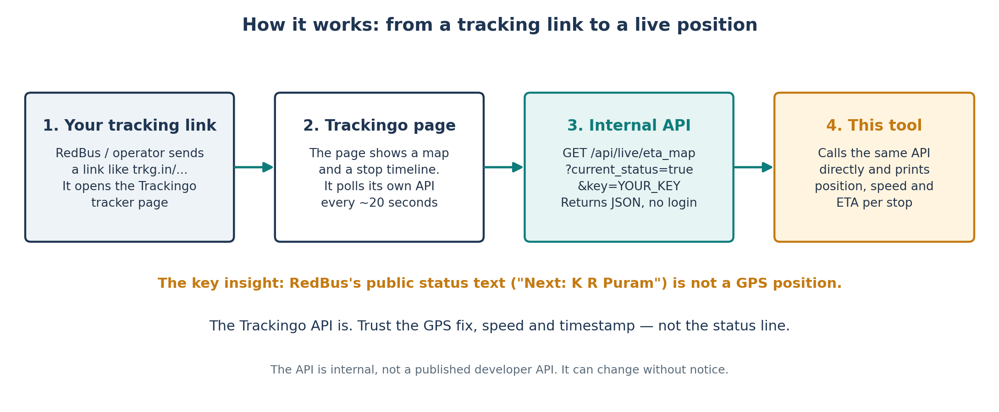
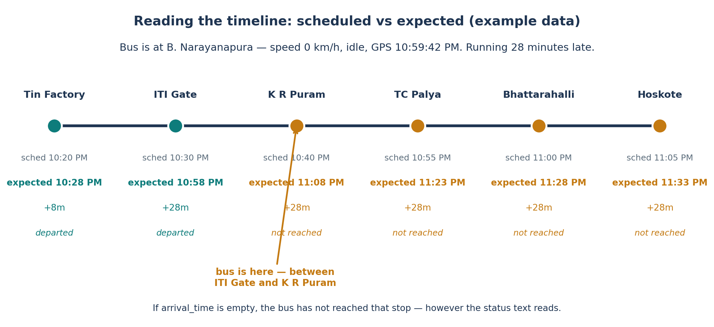
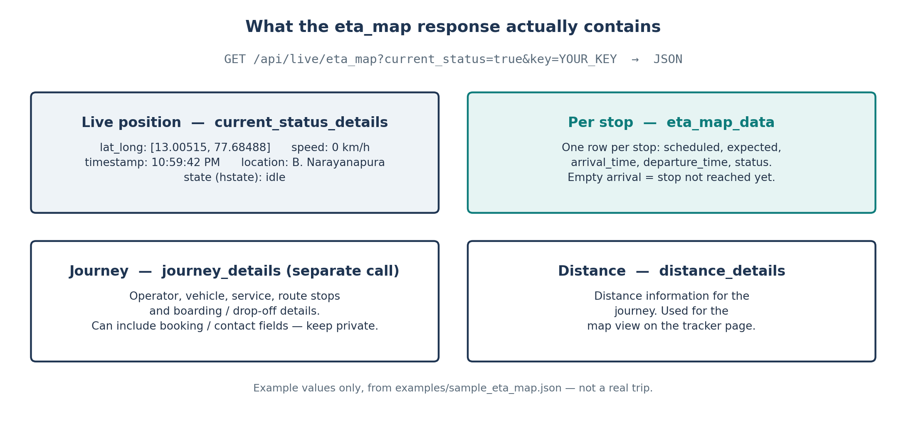

# Trackingo Bus Tracker

Live-track a bus from its Trackingo tracking link, using the tracker page's own API — no map scraping, no login.

## What it is

When an Indian bus operator (via RedBus or directly) sends you a live-tracking link, that link opens a Trackingo page (Trackingo is Bitla Software's fleet tracker). The page shows a map and a stop timeline, and it polls its own API about every 20 seconds for the bus's GPS position.

This tool calls that same API directly from the command line and prints the live position, speed, and ETA for every stop.



## Why this exists

RedBus's public live status is just text — "Next: K R Puram" — and it is easy to read that as "the bus has already passed ITI Gate". It is not a GPS position. The Trackingo API *is* GPS: latitude/longitude, speed, a GPS timestamp, and a location description. The lesson from the night this came out of: trust the GPS fix, not the status line.



If `arrival_time` for a stop is empty, the bus has not reached that stop yet, however the status text reads. In the example above the bus is sitting at 0 km/h, idle, between ITI Gate and K R Puram, 28 minutes late — it has not reached K R Puram or TC Palya.

## What the API returns



Two endpoints, found from the tracker page's own network requests:

```
GET https://bus.trackingo.in/api/live/journey_details?key=<KEY>&zoom_position=12&platform=mobile
GET https://bus.trackingo.in/api/live/eta_map?current_status=true&key=<KEY>
```

`eta_map` fields used here:

| Field | Meaning |
|---|---|
| `current_status_details.lat_long` | `[latitude, longitude]` |
| `current_status_details.details.speed` | Speed in km/h |
| `current_status_details.details.timestamp` | GPS update time |
| `current_status_details.details.location` | Location description |
| `current_status_details.details.hstate` | Vehicle state, e.g. `idle`, `moving` |
| `eta_map_data` | One row per stop: scheduled, expected, `arrival_time`, `departure_time`, status |
| `distance_details` | Distance information |

`journey_details` returns the operator, vehicle, service, route stops, and boarding / drop-off details. It can include booking / contact fields, so treat its output as private.

These are the website's **internal endpoints, not a published developer API**. They worked without a login in a fresh browser session, they may change without notice, and there is no public documentation for them. Use them for your own tracking link, at your own risk, and respect the site's terms.

## Getting your key

Your tracking key is the key in your own tracking link — the short link the operator sends you redirects to `bus.trackingo.in/customer/track_vehicle?<KEY>`. That key is yours: do not share it, and do not commit it. This repo contains only the placeholder `YOUR_KEY` and example data.

## Use

No dependencies beyond Python 3.10+.

```bash
# See it work with no key and no network, using the bundled example data
PYTHONPATH=src python3 -m trackingo_tracker --demo

# One live check for your own bus
PYTHONPATH=src python3 -m trackingo_tracker --key YOUR_KEY --once

# Keep watching, like the tracker page does (every 20 seconds)
PYTHONPATH=src python3 -m trackingo_tracker --key YOUR_KEY

# Raw JSON instead of the table
PYTHONPATH=src python3 -m trackingo_tracker --key YOUR_KEY --once --json

# Journey details instead of the live map (may include booking/contact fields)
PYTHONPATH=src python3 -m trackingo_tracker --key YOUR_KEY --journey --once
```

Example output (`--demo`, example data, not a real trip):

```
Live: B. Narayanapura, Devasandra (13.00515, 77.68488)
Speed: 0 km/h  State: idle  GPS at: 10:59:42 PM

Stop                   Sched      Expected   Delay   Arrived
Tin Factory            10:20 PM   10:28 PM   +8m     10:28 PM
ITI Gate               10:30 PM   10:58 PM   +28m    10:58 PM
K R Puram              10:40 PM   11:08 PM   +28m    -
TC Palya               10:55 PM   11:23 PM   +28m    -
Bhattarahalli          11:00 PM   11:28 PM   +28m    -
Hoskote                11:05 PM   11:33 PM   +28m    -
```

## Layout

```
src/trackingo_tracker/
  client.py    # fetch + parse + format + watch
  __main__.py  # CLI
tests/test_parse.py
examples/sample_eta_map.json   # example response, clearly labelled as example
docs/
  images/      # the three diagrams above (regenerate with docs/make_images.py)
  make_images.py
```

Run the test with plain Python (no pytest needed):

```bash
PYTHONPATH=src python3 -c "import sys; sys.path.insert(0, 'tests'); import test_parse; test_parse.test_parse_sample(); print('ok')"
```

## Privacy

This repo contains **no personal data**: no tracking key, no ticket number, no vehicle number, no phone number, no booking details, and no real trip. The sample data in `examples/` is illustrative and labelled as such. Keep your real key out of the repo, out of screenshots, and out of shared terminal output — especially the `journey_details` output.
